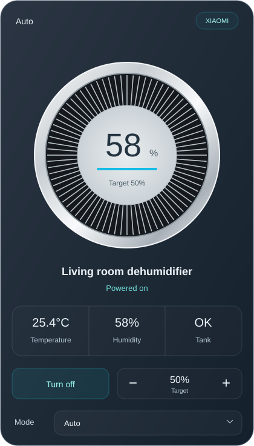

# Dehumidifier Card

A local-first Home Assistant dashboard card for dehumidifiers, featuring a silver circular grille, live humidity display, and a gently breathing status light.



*Illustration with fictional example values. No real home data is included.*

## Features

- Live humidity with the percent symbol next to the reading.
- Blue status bar with a slow 3.6-second fade while powered on and above the target.
- Solid green when powered on and at or below the target; solid gray when off or readings are unavailable.
- Power, target humidity, and device-supported mode controls.
- Optional temperature and water-tank sensors. Missing readings display a dash.
- Read-only mode enabled by default; no commands are sent while loading or rendering.
- English card labels by default, Thai labels for Thai Home Assistant profiles. Set `language: en` or `language: th` to override.
- Responsive layout, accessible control labels, and reduced-motion support.
- No external images, runtime dependencies, analytics, or cloud requests.

The light reflects reported power and humidity, not the compressor's operating state. The card does not automatically power the device off when it reaches its target.

## Install with HACS

This repository can be installed as a **custom repository**; it is not claimed to be included in the default HACS catalog.

1. Open **HACS → menu → Custom repositories**.
2. Add `https://github.com/JudewZA/lovelace-dehumidifier-card` and choose **Dashboard** (called **Lovelace** or **Plugin** in some versions).
3. Find **Dehumidifier Card** and download the latest version.
4. Reload the browser. If necessary, add this dashboard resource as a **JavaScript module**:

   `/hacsfiles/lovelace-dehumidifier-card/dehumidifier-card.js`

Keep only one resource for this card. The old `/hacsfiles/dehumidifier-card/…` path is not the resource path for this repository.

## Manual install

Download `dist/dehumidifier-card.js`, copy it to `/config/www/dehumidifier-card/`, and add `/local/dehumidifier-card/dehumidifier-card.js?v=2.2.0` as a JavaScript module in dashboard resources. Reload the browser after changing versions.

## Configuration

Add a **Custom: Dehumidifier Card** or use a manual card:

```yaml
type: custom:dehumidifier-card
entity: humidifier.example_dehumidifier
name: Living room dehumidifier
humidity_entity: sensor.example_humidity
temperature_entity: sensor.example_temperature
language: en
read_only: true
```

Replace the example entity IDs with your own. Remove optional sensor fields if you use attributes on the main entity instead. The main entity must be in the `humidifier` domain and expose a dehumidifier device through its integration.

### Enable controls

Set `read_only: false` to enable real device commands. Power, humidity changes, and mode selection operate the selected device immediately. Read-only mode is recommended when first checking your configuration.

```yaml
type: custom:dehumidifier-card
entity: humidifier.example_dehumidifier
language: en
read_only: false
```

| Option | Default | Description |
| --- | --- | --- |
| `entity` | Required | Main `humidifier.*` entity. |
| `name` | Entity friendly name | Card title. |
| `read_only` | `true` | Disable every device control. |
| `language` | HA profile language | `en` or `th`; other languages use English card labels. |
| `humidity_entity` | `current_humidity` attribute | Optional humidity sensor. The target is never used as the current reading. |
| `temperature_entity` | Temperature attribute | Optional temperature sensor. |
| `tank_entity` | None | Optional tank sensor; `on` means full, `off` means OK. |
| `tank_attribute` | `water_tank_full` if available | Optional attribute on the main entity. |
| `min_humidity` | Device attribute, otherwise `40` | Lower target limit. |
| `max_humidity` | Device attribute, otherwise `70` | Upper target limit. |
| `step` | `1` | Target adjustment increment. Use the step supported by your device. |

Use a numeric Celsius sensor for the temperature field. A tank level is never estimated from room humidity. Numeric or textual tank states are displayed as supplied by the integration.

Modes come from the entity's `available_modes`. Target buttons require the target-humidity supported feature. Controls are disabled when the main entity is missing/unavailable or a command is pending. Failed commands display an error; the card does not report optimistic success.

The visual editor exposes core configuration options. YAML can also set `language`.

## Compatibility and validation

Developed with a Xiaomi Smart Dehumidifier using Xiaomi Miot and Home Assistant 2026.9.4. Other dehumidifiers may work when they expose compatible `humidifier` entities. Device-specific controls must be checked with the relevant integration. Live power, mode, and target service calls have not been automatically exercised against a physical device.

## Troubleshooting

- **Custom element not found:** verify the resource URL, JavaScript module type, and browser refresh.
- **Old design persists:** remove duplicate resources and refresh the frontend cache.
- **Temperature or tank shows a dash:** configure the corresponding optional sensor or attribute; some devices do not supply it.
- **Controls are disabled:** check `read_only`, entity availability, and the device's supported features.
- **HACS download fails:** inspect the HACS log. Manual installation is available independently of the HACS downloader.

## License

MIT. See [LICENSE](LICENSE). This card does not require a cloud account or upload device data to this repository.
